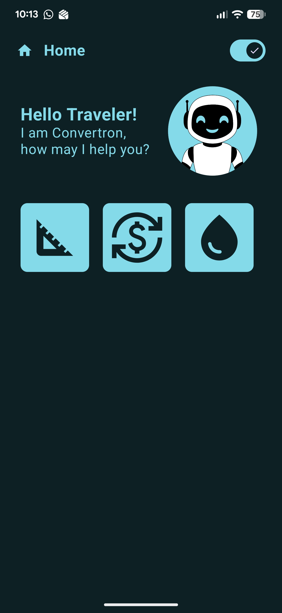
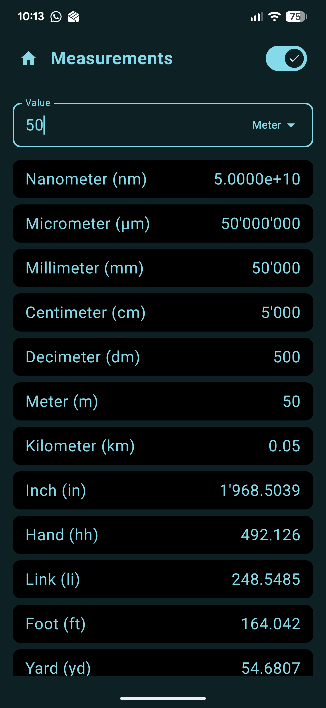
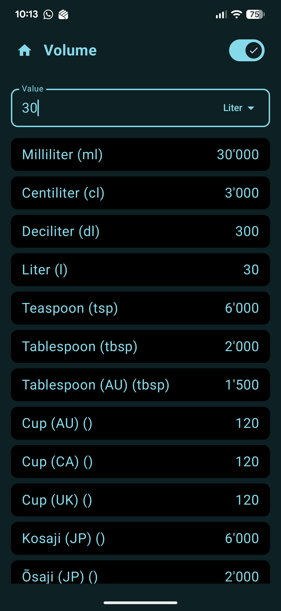
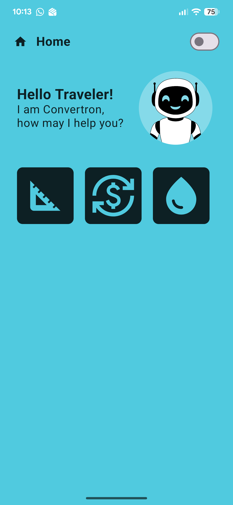
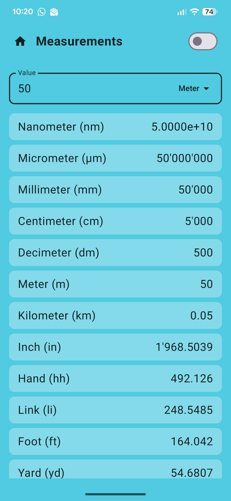

# Convertor

An Android app for everyday conversions, built with **Kotlin** and **Jetpack Compose**.
Your guide through the app is *Convertron*, a friendly robot assistant.

I build this app for my own daily use and keep extending it whenever I need a new tool.

## Screenshots

| Home (dark) | Length (dark) | Volume (dark) |
|:---:|:---:|:---:|
|  |  |  |

| Home (light) | Length (light) |
|:---:|:---:|
|  |  |

## Features

- **Length:** enter a value once and see it in all units at the same time: metric (nm to km), imperial (inch, foot, yard) and historical units such as hand and link
- **Volume:** metric units (ml to l) plus kitchen measures from different countries, e.g. teaspoon, tablespoon (incl. Australian), cups (AU, CA, UK) and Japanese kosaji / ōsaji
- **Dark and light mode**, switchable directly in the app
- **Readable numbers:** thousands separators and scientific notation for very large values

## Roadmap

- [ ] Currency conversion with live exchange rates via an external API
- [ ] Triangle calculator
- [ ] More everyday tools as needs come up

## Tech Stack

- Kotlin
- Jetpack Compose
- Android Studio
